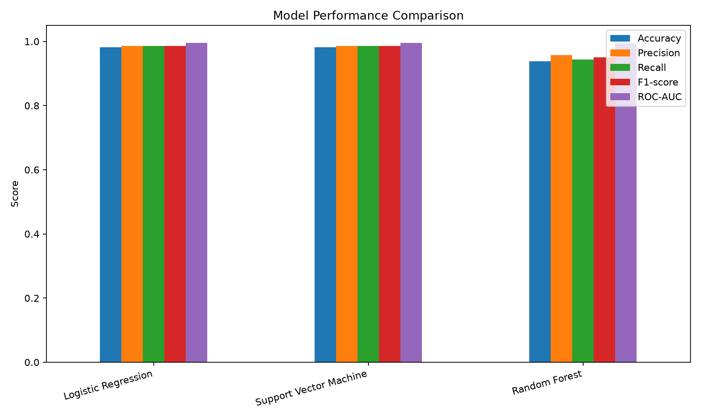
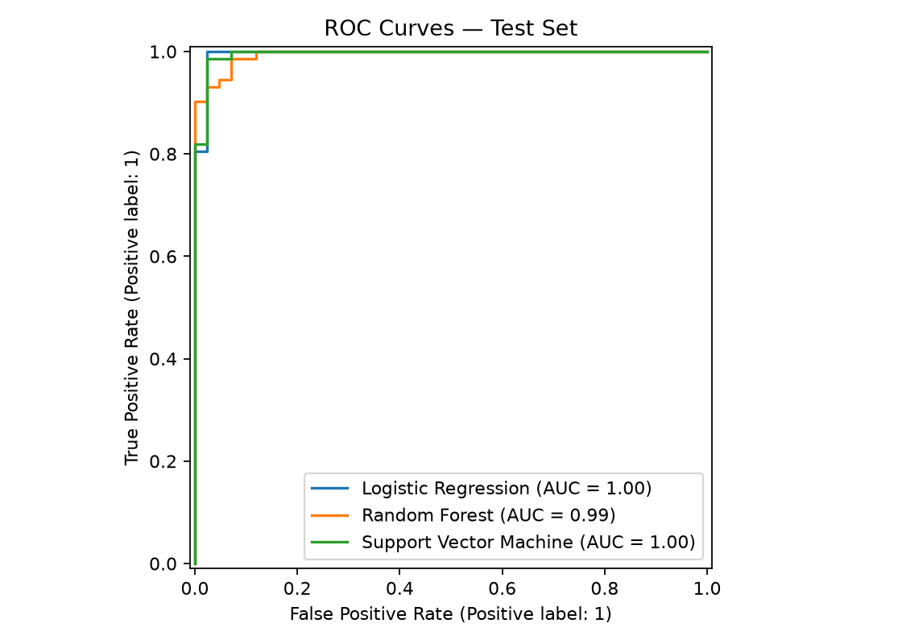
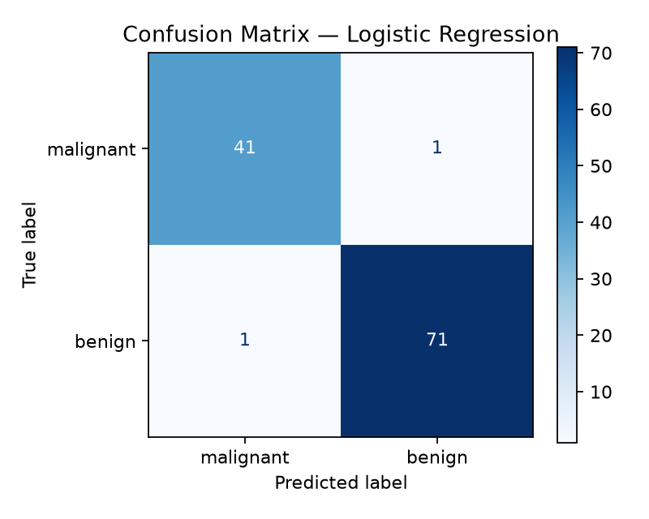

# 🧬 Disease Prediction Using Machine Learning

> **Machine Learning-Based Breast Cancer Classification**  
> Academic Project | Disease Prediction Using Machine Learning

A supervised machine learning project that uses the **Breast Cancer Wisconsin Diagnostic dataset** to classify tumors as malignant or benign. This project implements and compares three classification algorithms: Logistic Regression, Random Forest, and Support Vector Machine (SVM).

---

## 👨‍🎓 Student Information

| Information | Details |
|---|---|
| Student Name | Md. Rasel Ahmed |
| Student Id | 2671556 |
| Course Name | ICT 6700 - Special Study in Information & Communication Technology (Federated AI Security for Healthcare) |
| Project Title | Disease Prediction Using Machine Learning |
| Programming Language | Python |
| Project Type | Machine Learning / Binary Classification |
| Program | M. Sc. Engg. in Information and Communication Technology |

---

## 🎯 Project Objective

The primary objective of this project is to develop a machine learning-based classification system that can distinguish between malignant and benign breast tumors using diagnostic features.

The project aims to:

- Explore and understand a real-world medical dataset.
- Perform data inspection and preprocessing.
- Implement multiple supervised machine learning algorithms.
- Evaluate model performance using standard classification metrics.
- Compare the results of different models.
- Visualize model performance through graphs and confusion matrices.

---

## 🧬 Dataset Description

This project uses the **Breast Cancer Wisconsin Diagnostic (WDBC) dataset**, which is available directly through the Scikit-learn library.

**Dataset source:** [Scikit-learn Breast Cancer Dataset Documentation](https://scikit-learn.org/stable/modules/generated/sklearn.datasets.load_breast_cancer.html)

### Dataset Summary

| Attribute | Description |
|---|---|
| Dataset Name | Breast Cancer Wisconsin Diagnostic |
| Data Source | Scikit-learn |
| Total Samples | 569 |
| Total Features | 30 |
| Problem Type | Binary Classification |
| Target Classes | Malignant and Benign |

### Target Classification

The dataset contains two target classes:

| Class Label | Diagnosis |
|---|---|
| 0 | Malignant |
| 1 | Benign |

- **Malignant:** A cancerous tumor.
- **Benign:** A non-cancerous tumor.

The 30 numerical features describe characteristics of cell nuclei obtained from digitized images of breast mass samples.

---

## ⚙️ Project Methodology

The project follows a structured machine learning workflow:

```text
        Dataset Loading
               |
               ▼
        Data Exploration
               |
               ▼
       Data Preprocessing
               |
               ▼
        Train-Test Split
               |
               ▼
       Feature Standardization
               |
               ▼
      Model Implementation
               |
       ┌───────┼────────┐
       ▼       ▼        ▼
      LR       RF       SVM
       |       |        |
       └───────┼────────┘
               |
               ▼
       Model Evaluation
               |
               ▼
       Performance Comparison
               |
               ▼
        Results Visualization
```

### 1. Data Loading and Exploration

The dataset is loaded using `load_breast_cancer()` from Scikit-learn.

Initial inspection includes:

- Dataset dimensions and feature information.
- Target class names and labels.
- Checking for missing values.

The dataset contains 569 samples and 30 features, with no missing feature values.

### 2. Data Preprocessing

The following preprocessing techniques are applied:

- **Train-Test Split:** The dataset is divided into 80% training data and 20% testing data.
- **Stratified Sampling:** `stratify=y` maintains the class distribution in both sets.
- **Random State:** `random_state=42` ensures reproducibility.
- **Feature Standardization:** `StandardScaler` is applied to Logistic Regression and SVM through Scikit-learn pipelines.
- **Data Leakage Prevention:** The scaler is fitted on training data only.

Random Forest is trained without feature standardization.

---

## 🤖 Machine Learning Models

Three supervised classification algorithms are implemented and compared.

### 1. Logistic Regression (LR)

Logistic Regression is a supervised classification algorithm used to estimate the probability that an observation belongs to a particular class.

In this project, it is used as a baseline classification model for distinguishing malignant and benign tumors.

### 2. Random Forest (RF)

Random Forest is an ensemble learning algorithm that combines multiple decision trees to improve classification performance.

The implementation uses:

- 300 decision trees (`n_estimators=300`).
- `random_state=42` for reproducibility.
- `class_weight="balanced"` to account for class imbalance.

### 3. Support Vector Machine (SVM)

Support Vector Machine is a supervised learning algorithm that identifies an optimal decision boundary between different classes.

This project uses an SVM classifier with an RBF (Radial Basis Function) kernel. Feature standardization is applied before model training.

---

## 📊 Model Evaluation Metrics

The models are evaluated using the following performance metrics:

| Metric | Description |
|---|---|
| Accuracy | Measures the overall proportion of correct predictions. |
| Precision | Measures how many positive predictions are actually positive. |
| Recall | Measures how many actual positive samples are correctly identified. |
| F1-Score | Represents the harmonic mean of precision and recall. |
| ROC-AUC | Measures the model's ability to distinguish between the two classes. |

**Metric interpretation:** In the main results table, class `1` (Benign) is treated as the positive class for Precision, Recall, and F1-score.

---

## 📈 Experimental Results

All three models are evaluated using the same held-out test dataset.

### Model Performance Comparison

| Model | Accuracy | Precision | Recall | F1-Score | ROC-AUC |
|---|---:|---:|---:|---:|---:|
| Logistic Regression | 98.25% | 98.61% | 98.61% | 98.61% | 0.9954 |
| Support Vector Machine | 98.25% | 98.61% | 98.61% | 98.61% | 0.9950 |
| Random Forest | 94.74% | 95.83% | 95.83% | 95.83% | 0.9937 |

*Note: Results are from the project's reproducible 80:20 train-test split.*

### Result Analysis

The experimental results demonstrate that all three models achieved strong classification performance on the selected test dataset.

Key observations:

- Logistic Regression achieved 98.25% accuracy and the highest ROC-AUC score of approximately 0.9954.
- Support Vector Machine achieved the same accuracy, precision, recall, and F1-score as Logistic Regression.
- Random Forest achieved 94.74% accuracy, with an ROC-AUC score of approximately 0.9937.
- Logistic Regression and SVM performed slightly better than Random Forest on this particular test split.

Based on these results, Logistic Regression and SVM demonstrated the strongest overall classification performance in this experiment.

---

## 📉 Results Visualization

The project generates several visualizations to make model performance easier to understand.

### 1. Model Performance Comparison

This graph compares Accuracy, Precision, Recall, F1-score, and ROC-AUC across the three classification algorithms.



### 2. ROC Curve Comparison

The ROC curves illustrate how effectively the models distinguish between the two target classes.



### 3. Confusion Matrices

Confusion matrices provide a detailed view of correct and incorrect predictions for each model.

**Logistic Regression**



**Random Forest**


**Support Vector Machine**


---

## 🏆 Conclusion

This project successfully demonstrates the application of supervised machine learning algorithms to breast cancer classification using the Breast Cancer Wisconsin Diagnostic dataset.

Three classification algorithms—Logistic Regression, Random Forest, and Support Vector Machine—were implemented and evaluated.

Based on the experimental results, Logistic Regression and SVM achieved the highest accuracy of **98.25%**, while Logistic Regression achieved the highest ROC-AUC score of approximately **0.9954**.

The experiment demonstrates how machine learning techniques can be applied to medical datasets for classification and comparative performance analysis.

Overall, the project provides practical experience in data preprocessing, model implementation, performance evaluation, and visualization.

---

## ⚠️ Limitations and Ethical Considerations

Although the models achieved strong results, several limitations should be considered:

- The experiment uses a single train-test split rather than extensive cross-validation.
- The dataset is a benchmark dataset and may not fully represent current clinical populations.
- The reported Precision, Recall, and F1-score use the benign class as the positive class.
- Malignant-class recall and false-negative predictions require particular attention in medical applications.
- Further validation using independent datasets and clinical expertise would be necessary before any real-world application.

**Important:** This project is developed strictly for educational and academic purposes. It is not a clinically validated diagnostic system and must not be used for medical diagnosis or treatment decisions.

---

## 🛠️ Technologies and Libraries Used

| Technology | Purpose |
|---|---|
| Python | Main programming language |
| Pandas | Data handling and analysis |
| Scikit-learn | Dataset loading, preprocessing, model training, and evaluation |
| Matplotlib | Data visualization |
| Jupyter Notebook | Interactive development and experimentation |

### Important Scikit-learn Components

- `load_breast_cancer()`
- `train_test_split()`
- `StandardScaler()`
- `Pipeline()`
- `LogisticRegression()`
- `RandomForestClassifier()`
- `SVC()`
- `accuracy_score()`
- `precision_score()`
- `recall_score()`
- `f1_score()`
- `roc_auc_score()`
- `ConfusionMatrixDisplay`
- `RocCurveDisplay`

---

## ▶️ How to Run the Project

### Step 1: Clone the Repository

```bash
git clone https://github.com/durlovrasel/Disease-Prediction-ML.git
```

### Step 2: Navigate to the Project Directory

```bash
cd Disease-Prediction-ML
```

### Step 3: Create a Virtual Environment

```bash
python -m venv .venv
```

### Step 4: Activate the Virtual Environment

**Windows PowerShell:**

```powershell
.venv\Scripts\Activate.ps1
```

### Step 5: Install Dependencies

```bash
pip install -r requirements.txt
```

### Step 6: Run the Python Script

```bash
python disease_prediction.py
```

Alternatively, open `disease_prediction.ipynb` using Jupyter Notebook or JupyterLab and run the notebook cells.

After execution, the evaluation metrics and visualization files will be generated and saved in the `results/` directory.

---

## 📁 Project Structure

```text
Disease-Prediction-ML/
│
├── disease_prediction.py
├── disease_prediction.ipynb
├── README.md
├── requirements.txt
├── .gitignore
│
└── results/
    ├── model_metrics.csv
    ├── model_comparison.png
    ├── roc_curves.png
    ├── confusion_matrix_logistic_regression.png
    ├── confusion_matrix_random_forest.png
    └── confusion_matrix_support_vector_machine.png
```

---

## 📌 Academic Note

This project was developed as part of an academic assignment on **Disease Prediction using Machine Learning**.

It demonstrates the practical application of machine learning concepts, including data preprocessing, supervised classification, model evaluation, and visualization.

**Student Name:** Md. Rasel Ahmed  
**Student Id:** 2671556
